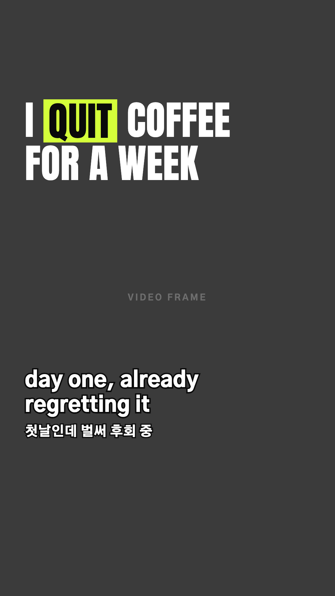
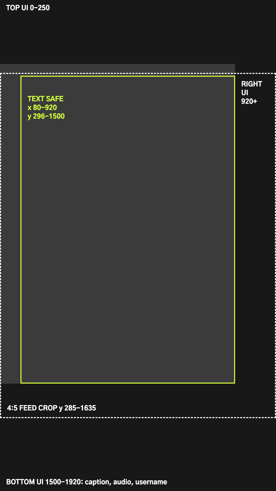
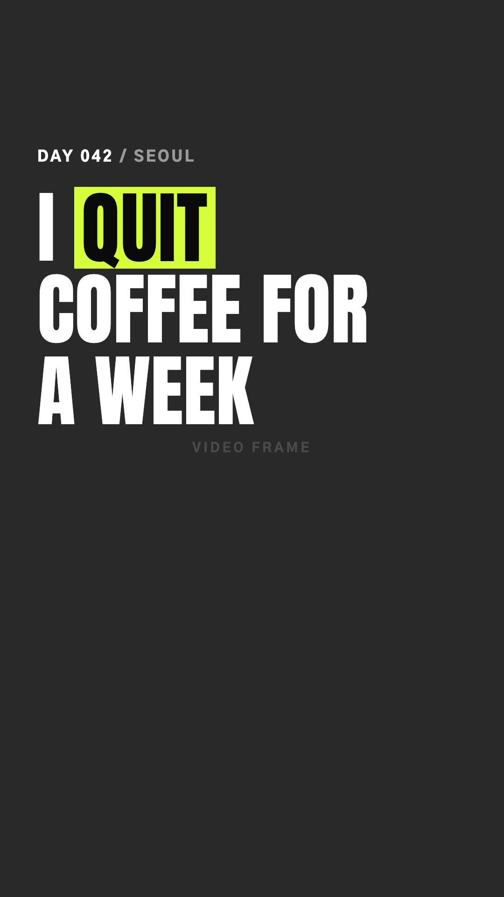
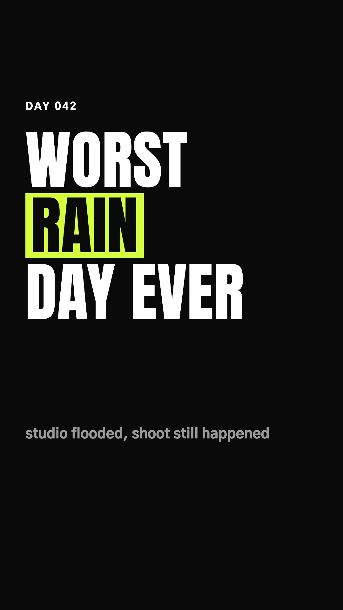

# Reels Brand and Content Guide

Status: APPROVED v4.2 (2026-11-19). v4.1 signed off by Design Review and approved by woosik; v4.2 adds woosik's rulings on the Editing Team's three asks (`docs/editing/playbook.md` section 12). Replaces v3.1 (real footage), archived in `archive/v3.1/`. v2 (calm paper diary) is in `archive/v2/`.

Content: **AI-generated images only** (woosik, 2026-11-19). Reels are built from generated stills by `reel-renderer/`, in two modes (`docs/photo-reel-concept.md` section 3): **story mode**, where each image holds while its narrated line plays, and **beat mode**, where images cut on the music. Audience: United States first.

Every reel made from generated images carries Instagram's AI label and is never presented as real life (`docs/team.md` rule 11).

Language: **English everywhere** (covers, captions, hashtags, headlines, labels). **Story subtitles are the only bilingual element**: English line on top, Korean translation below (woosik, 2026-11-19).

Direction in one sentence: **loud text over a generated character, up close.** Black and white type, one acid-lime word, condensed headlines on black backplates, heavy outlined subtitles, a big, well-lit character, one uniform film grain over every frame.

How images should look is in [`ai-image-brief.md`](ai-image-brief.md), the brief for the AI Image Team.

Why this direction (research, 2026-11-18; vendor and press sources, treat numbers as directional):
- Captions or text overlays appear in about 80% of viral clips in OpusClip's 1.95M-clip analysis; many viewers watch with sound off ([OpusClip](https://www.opus.pro/research/how-to-go-viral-instagram-reels)).
- The first 1 to 2 seconds decide retention ([Manychat](https://manychat.com/blog/instagram-trends-for-creators-2026/)).
- Adam Mosseri names watch time, likes per reach and sends per reach as the top Reels signals ([Lindsey Gamble](https://www.lindseygamble.com/blog/unpacking-instagrams-focus-on-sends-per-reach-a-timeline-why-it-matters-and-tips-for-creators-brands)).
- Instagram capped hashtags at 5 per post and Reel in December 2025 ([Social Media Today](https://www.socialmediatoday.com/news/instagram-implements-new-limits-on-hashtag-use/808309/)).
- Socialinsider data on 140K business Reels: 30 to 60 second Reels had the highest reach rate; small accounts see the highest early skip rates (relayed by [Bento](https://bentosocial.ai/blogs/instagram-hooks-reels), unverified at source).

Files in this folder:

| File | Use |
| --- | --- |
| `ai-image-brief.md` | Visual brief for generated image sets: palette, light, composition zones, consistency. |
| `templates/reels-templates.html` | Layout reference for covers, hook, subtitle and safe areas. Open with `#cover-photo`, `#cover-text`, `#hook`, `#subtitle` or `#safe-area`. The gray "VIDEO FRAME" is where a generated image goes; sample words are layout placeholders. |
| `images/` | Renders of those templates. |
| `archive/` | Earlier versions, for reference only. |

---

## 1. Visual direction

### Color

| Token | Hex | Role |
| --- | --- | --- |
| Black | `#0A0A0A` | Backplates, subtitle outlines, text on Volt, text covers. |
| White | `#FFFFFF` | Headline and subtitle fill. |
| Gray | `#9A9A9A` | Secondary text (cover dek). |
| Volt | `#D4FF3A` | Accent. **Exactly one Volt word on frame 0 and on the cover; at most one on every other frame**, counted across headline and subtitle. Story subtitles may carry none. |

The images carry their own color (see the brief). Graphics never take color from the image, and no image may contain a large Volt-like yellow-green area, so the accent stays the only one.

### Type

| Family | Job | Weights |
| --- | --- | --- |
| Anton | Headlines and cover titles only. Always uppercase. Latin only. | 400 |
| Gothic A1 | Subtitles (English and Korean), labels, dek. | 700, 800, 900 |

Both are free on Google Fonts (SIL OFL). Gothic A1 covers Korean and Latin.

| Element | Font | Size / line height |
| --- | --- | --- |
| Text cover headline | Anton | 200 / 1.04 |
| Image cover headline | Anton | 168 / 1.04 |
| Hook headline (in video) | Anton | 128 / 1.04 |
| Subtitle, English | Gothic A1 900, 10 px black stroke | 68 / 1.18 |
| Subtitle, Korean | Gothic A1 800, 8 px black stroke | 42 / 1.35 |
| Label (tag, time) | Gothic A1 900, tracking 0.14em, uppercase, on a black backplate | 32 |
| Cover dek | Gothic A1 800, Gray | 44 / 1.25 |

Spacing: 8 px base unit. Left margin 80 px on every frame. Everything is left-aligned.

### On-screen text



- **Hook headline:** Anton, uppercase, 2 to 6 words, one Volt word that appears once, top of the text-safe box from y 296. On screen from 0.0 s for at least 1.5 s.
- **Headline backplates:** every headline line sits on a solid black backplate (padding 12 px 20 px 10 px, 8 px between lines); the accent word sits on a Volt backplate. This keeps text readable on any image without a scrim. It is the brand's signature device.
- **Headline fit:** at most 13 characters per line at 128 px and 10 at 168 px. The renderer's width check must pass.
- **Story subtitles (story mode only):** the narrated line, one at a time, white Gothic A1 with a black stroke, bottom edge at y 1420. English on top (one sentence at a time, at most 2 lines of about 22 characters), the Korean translation of that same sentence below (1 line, at most 19 character widths by the renderer's estimate: Hangul 1, capital 0.8, space 0.3, other 0.6). No backplate behind subtitles.
- **Beat mode has no subtitles.** It may show up to 3 short text beats (2 to 4 words), one at a time, never over the hook headline.
- **Accent word:** the emotional or surprising word. Never a filler word such as "for", "a" or "the". While the hook headline is on screen, subtitles carry no Volt word.
- **Labels:** small black-backplate labels at the bottom left of the text-safe box, bottom edge at y 1500: the per-image time (`8:42 AM`), only when the script gives a story time, and the closing tag (`EP 02` or `DAY 042`). A time label is never presented as a real timestamp. In story mode they sit side by side; in beat mode the tag stacks above the time. A series tag (`EP NN`) shows twice: from frame 0 for as long as the hook headline is on screen, so a viewer who joins mid-series knows it is a series, and again on the closing image. Label placement matches `reel-renderer/src/PhotoReel.tsx`; the frame-0 series tag is not yet implemented (requested from Engineering, section 9).
- **Grain:** one monochrome grain over the whole frame at 14% opacity, overlay blend, reseeded every frame (SVG `feTurbulence` fractalNoise, baseFrequency 0.9, 2 octaves, desaturated). The renderer adds it. Images are generated without grain.
- No drop shadows, no emojis, no stickers, no bouncing or spinning text. Word-by-word pop-in is allowed. Word-by-word color highlighting (karaoke captions) is not: it breaks the one-Volt-word rule.
- Korean words never split across lines, and no line ends on one stray word.

### Safe areas (1080x1920)



| Zone | Pixels | Rule |
| --- | --- | --- |
| Top UI | y 0 to 250 | No text. |
| Bottom UI (caption, audio, username) | y 1500 to 1920 | No text. |
| Right action buttons | x 920 to 1080 | No text. |
| 4:5 feed crop | y 285 to 1635 | Cover headline must be inside this. |
| **Text-safe box** | **x 80 to 920, y 296 to 1500** | All text, every frame and every cover. |

Text occupancy inside the box, for image composition (details in the brief): headline about y 296 to 620 on the opening image; subtitles about y 1180 to 1420 (two English lines plus the Korean line: 2 x 80.2 + 16 + 56.7 = 233 px above y 1420); labels about y 1446 to 1500. The UI zones are conservative estimates, not yet checked on a real phone.

---

## 2. Cover images

The Graph API takes `cover_url` (a public JPEG) or `thumb_offset` (milliseconds into the video). Prefer `cover_url`.

Not wired yet: `reels_queue` has no `cover_url` column and the publisher sends no cover, so Instagram picks the cover frame until that ships.

| Image cover | Text cover |
| --- | --- |
|  |  |
| The strongest image of the set, tag, headline on backplates with one Volt word. Default. | Black background, headline at 200 px, gray dek. For sets with no strong single image. |

Rules:
- Cover headline = the hook headline, word for word.
- Tag: `DAY NNN` counts every post on the account. A series episode shows `EP NN` in place of `DAY NNN` in the tag and the sign-off; its post still advances the DAY count. `/ SERIES` in Gray (for example `EP 02 / RUDY`) is for the cover only. The `EP` tag has not been rendered yet; check it on the first episode render.
- True to the video. No promise the video does not deliver.
- Export 1080x1920 JPEG, sRGB, quality 85 to 90.

Export from `design/brand/`:

```bash
"/Applications/Google Chrome.app/Contents/MacOS/Google Chrome" --headless=new --hide-scrollbars --virtual-time-budget=8000 --window-size=1080,1920 --screenshot="$PWD/cover.png" "file://$PWD/templates/reels-templates.html#cover-photo"
```

```bash
sips -s format jpeg -s formatOptions 90 cover.png --out cover.jpg
```

---

## 3. Hook and edit rules

Every rule below can be checked from the video file or its frames.

- **Frame 0** is the opening image already moving. The opening image always pushes in. No black frame, fade-in, logo or title card.
- **0.0 s:** the hook headline is on screen and stays at least 1.5 s.
- **Story mode:** the first subtitle is on screen by 0.5 s (the renderer starts the first line at 0.2 s).
- **Beat mode:** no subtitle rule applies.
- **First 6 s:** nothing holds longer than 2 s. A long hold is broken by crop cuts to the same image. A crop cut counts as a cut only when each step is at least 1.2x (`CROP_STEP` in `reel-renderer/src/spec.ts`) and the character's face, hands and story action stay at rendered y 1176 or above (the subtitle block starts near y 1180) in every rendered frame, crops included.
- **Allowed moves on an image** (woosik, 2026-11-19): push-in 1.00 to 1.08 (default); pull-out 1.08 to 1.00; drift at a fixed 1.06 with a sideways move of at most 2% of the width (21.6 px) across the hold; crop cuts as above. No rotation, shake, spin or whip. The same move must not appear on more than 2 images in a row. Drift is not used on images that get crop cuts in the first 6 s; those images push in only. Every move keeps the face box inside the limits of `ai-image-brief.md` section 3.1.
- **Sound effects:** at most 4 per reel, on story beats only, with peaks at least 6 dB under the voice peak (a human listening check until QA can measure it), never a stock whoosh on every cut. Music and sound effects must be original or licensed.
- **Hook headline may** address the viewer or ask a question. It **may not** contain a banned term (section 6) or promise something the video does not show.
- **Length:** target 20 to 45 s (warn outside), hard range 7 to 60 s (block outside).
- **Formats that fit:** a recurring character in an "X vs Y" series ("Raccoon vs the roommate"), a plan that goes wrong, before and after, a small mystery solved in the last image.
- **No repeats:** the headline's first two words must not match any hook from the last 14 posts. A series may reuse its frame ("RACCOON VS"), so for a series the check runs on the words after the frame.

---

## 4. Caption formula

English only. Blocks separated by blank lines. 150 to 500 characters, hard limit 2,200.

```
[1. Hook line]   Raccoon vs the roommate

[2. Body, 1 to 3 short lines]
rudy's plan: find a roommate.
four interviews. one drum kit. one snake named rudy.
he found the one. there is a catch.

[3. Prompt, optional]   what was your worst roommate interview?

[4. Sign-off]   EP 02 · 2026.11.21

[5. Hashtags]   #storytime #roommates #roommatelife
```

- Line 1 is the cover headline in sentence case, word for word. It must work alone in the one-line feed preview.
- Body lines are short. Lowercase is fine. Each line is at most 60 characters. Do not reveal a story's turn.
- Sign-off: the cover tag (`EP NN` or `DAY NNN`), then the **post date in US time** (woosik, 2026-11-19). The cron posts at 17:00 UTC, which is 07:00 to 13:00 on the same calendar day in every US time zone, so one date fits all of them.
- Never describe generated scenes as real ("real", "actually happened", "caught on camera"). Characters and places are fiction.
- No emojis, no links, no all-caps words outside the sign-off tag.

## 5. CTA and hashtags

CTA:
- The only CTA is the optional prompt in block 3: one question of 60 characters or fewer, about the viewer.
- Use it on at most 2 of any 7 consecutive posts. The posts without it are the control group.
- Never ask for follows, likes, saves, shares or tags.

Hashtags:
- 3 to 5, lowercase English, at the end. Instagram's cap is 5.
- 1 or 2 broad tags from a rotating pool: `#storytime #animation #shortstory #cartoon #dailylife`.
- 1 or 2 topic tags for the episode (`#roommates`, `#nycapartment`).
- One fixed series tag once the series name is set. It counts toward the 5.
- Change at least 2 tags versus the previous post. Never `#reallife` or any tag that claims the content is real.

## 6. Banned terms (machine-checkable)

Hook headline, cover and caption. Match case-insensitive whole words or phrases (word boundaries), so `tag a` does not hit "tag along" and `secret` does not hit "secretly". Hashtags match by prefix.

- **Bait:** `wait for it`, `watch till the end`, `you won't believe`, `secret`, `part 2` (unless a part 2 exists).
- **Hard CTA:** `follow for`, `link in bio`, `share this`, `tag a`, `comment below`, `subscribe`. Bare `like` is allowed, to avoid false hits such as "felt like".
- **Conditional CTA:** `like this` and `save this` are banned only in CTA form: at the start of a line, or followed by `if`, `for`, `post`, `reel`, `video`, end punctuation or the end of the line. "felt like this was the day" and "I want to save this moment" pass; "save this moment" at the start of a line fails.
- **Real-life claims (new in v4):** `real footage`, `caught on camera`, `true story`, `actually happened`, `#reallife`.
- **Hashtags:** `#fyp`, `#viral`, `#explore`, `#reels`, `#foryou`.

## 7. How we will know it works

Read per Reel at the day-7 snapshot. Use medians. Exclude posts with reach under 100.

| Metric | Formula | Measures |
| --- | --- | --- |
| Watch ratio | average watch time / duration | Hook and edit |
| Sends per reach | shares / reach | Shareability (top signal) |
| Likes per reach | likes / reach | Resonance |
| Comments per 1,000 reach | comments / reach x 1000, prompt vs no-prompt posts | CTA |

Graph API field names (`ig_reels_avg_watch_time`, `reach`, `shares`, `likes`, `comments`) are unverified. The Analytics Team reported that the API exposes `shares`, not sends.

Decision rule after **28 posts** (wait until 42 if fewer than 20 qualify). Change **at most one rule per 28-post block**, and keep a change only if its metric improves 10% or more:
- **Hook:** if median watch ratio is below 40%, shorten the target length to 15 to 30 s for the next block.
- **Prompt:** if prompt posts reach 1.5x the comments per 1,000 reach of no-prompt posts, allow 3 of 7. At 1.0x or less, drop it.
- **Hashtags:** do not tune.

---

## 8. Pre-approval checklist

Run this before a row in `reels_queue` is set to `approved`.

**File (Graph API limits)**
- [ ] MOV or MP4, H.264 or HEVC video, AAC audio.
- [ ] 23 to 60 fps. 3 s to 15 min (target 20 to 45 s). 300 MB or less.
- [ ] 9:16, ideally 1080x1920.
- [ ] `video_url` is a public https URL that returns the file directly.

**Hook and brand**
- [ ] Frame 0 is the opening image in motion with the hook headline on screen.
- [ ] Story mode: first subtitle visible by 0.5 s, English over Korean, Korean translation checked.
- [ ] Exactly one Volt word on frame 0 and the cover; at most one on any other frame. Only Anton and Gothic A1.
- [ ] All text inside the text-safe box. In every frame, crops included, the character's face, hands and story action stay at rendered y 1176 or above (the subtitle block starts near y 1180), clear of the subtitles.
- [ ] Cover headline = hook headline = caption line 1.

**Caption**
- [ ] Formula followed, 150 to 500 characters, English only, no emojis.
- [ ] 3 to 5 hashtags. Prompt used on no more than 2 of the last 7 posts.
- [ ] No banned terms (section 6).
- [ ] Sign-off date = the post date in US time (the `scheduled_at` day, 17:00 UTC).

**AI images, rights and safety**
- [ ] Every image passes the checks in `ai-image-brief.md` section 6, including brightness and character size.
- [ ] Instagram's AI label is on for this post. Whether the publisher can set it through the API is unverified; until that is verified, a reel cannot pass this check. Nothing presents the content as real life.
- [ ] No real person other than woosik, no real brand or logo, no readable text inside images.
- [ ] Music is original or licensed. `test-120` is never published.

---

## 9. Open requests to other teams (v4)

Design does not edit these files. Each request goes through woosik or the coordinator.

1. **Engineering (done 2026-11-19):** story subtitles render English only. Add the Korean line below it (Gothic A1 800, 42 px, line height 1.35, 8 px black stroke, 16 px gap), keeping the block's bottom edge at y 1420. Needs a Korean field per line in the script input.
2. **Engineering (done 2026-11-19):** the grain comment in `reel-renderer/src/PhotoReel.tsx` (line 130) points to `design/brand/templates/comps.html`, which was deleted on 2026-11-19. Point it to this guide, section 1 "Grain". Comment only; the recipe is unchanged.
3. **Production:** `docs/growth-plan.md` (lines 57, 88, 89) and `docs/production/example-2-rudy-script.md` (line 55) still describe the sign-off and subtitle rules as open. Both are settled here: US post date; subtitles in story mode only.
4. **Coordinator (closed: the file is frozen until the first post):** `docs/automation-agents.md` lines 106 and 107 still describe real footage and the old sign-off. That file has no owner in `docs/team.md`.
5. **QA:** v4 adds the "real-life claims" banned terms (section 6) and makes the subtitle check story-mode only (section 8). Also: `docs/lessons-learned.md` L-002 still records the KST shoot date as resolved; the sign-off check should accept `EP NN` as well as `DAY NNN`; the Volt rule is now exactly one on frame 0 and the cover, at most one elsewhere.
6. **Engineering:** crop cuts scale about the image centre, so a point at y lands at 960 + (y - 960) x zoom x 1.08, and at the maximum (2 x 1.08 = 2.16) anything below about y 1060 in the source enters the subtitle band (y 1180). Requested: crop toward a per-image focal point (an `x, y` in the image list) instead of the centre, and cap the crop at 1.44 when a source image is under 1080 px native width (a 2.16 crop of a 768 px source is about a 3x upscale).
7. **Engineering:** show a series tag (`EP NN`) from frame 0 for the headline's duration; today `PhotoReel.tsx` shows the tag only from the closing segment (`spec.tag && frame >= close.from`). Also the v4.2 moves (pull-out, drift) and an optional sound-effect layer.
