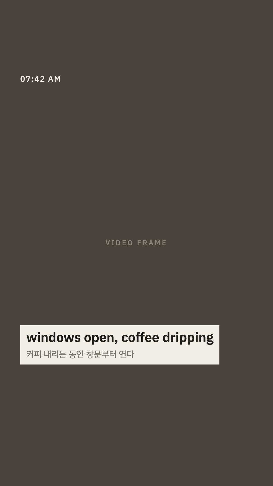
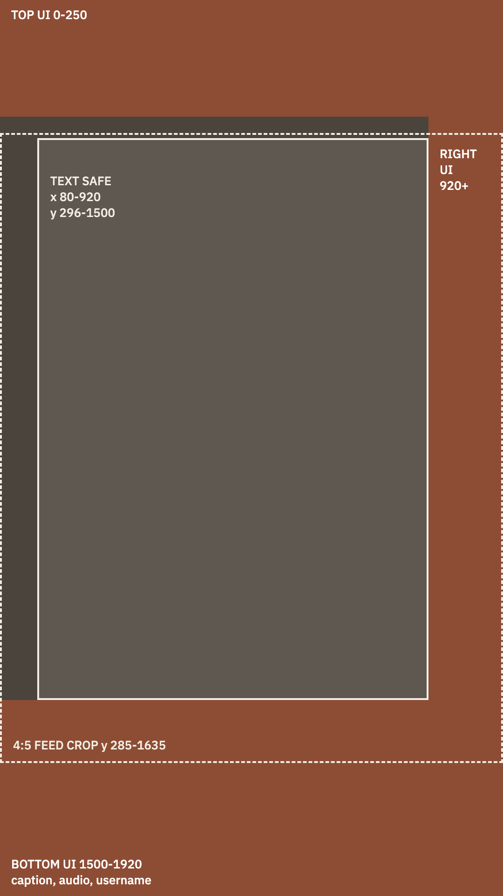
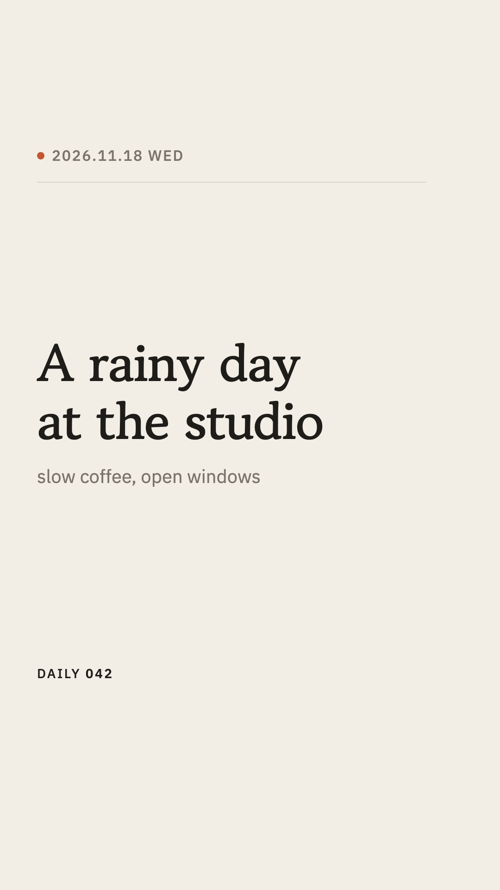
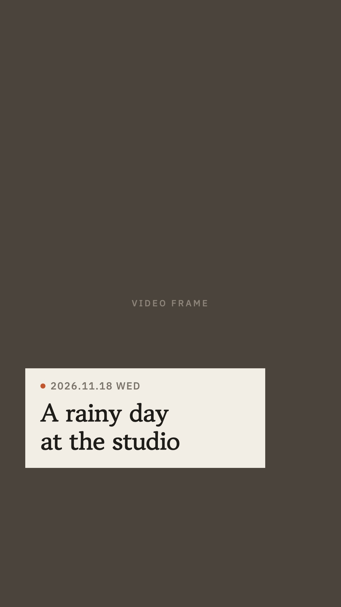

# Reels Brand and Content Guide

Status: APPROVED v2 (2026-11-18).

Account: personal daily-life vlog. Calm, minimal mood.

Language: **English everywhere** (covers, captions, hashtags). **On-screen subtitles are the only bilingual element**: English line on top, Korean translation below.

Direction in one sentence: **a paper diary page, not a feed post.** Warm rice-paper white, ink-black serif titles, one small persimmon dot as the only accent, everything left-aligned to one margin.

Files in this folder:

| File | Use |
| --- | --- |
| `templates/reels-templates.html` | Editable source for every template. Open with `#cover-text`, `#cover-photo`, `#subtitle` or `#safe-area`. |
| `images/cover-text.jpg` | Sample text-only cover (1080x1920 JPEG). |
| `images/cover-photo.jpg` | Sample photo cover with paper label (placeholder frame). |
| `images/subtitle.png` | Sample on-screen subtitle frame. |
| `images/safe-area.png` | Safe-area overlay for 9:16. |

---

## 1. Visual direction

### Color

| Token | Hex | Role |
| --- | --- | --- |
| Paper | `#F2EEE6` | Dominant. Cover background, subtitle and title labels. |
| Ink | `#1F1D1A` | All primary text. |
| Stone | `#7A746A` | English lines, date stamps, secondary text. |
| Mist | `#D9D3C7` | Hairline rules only. |
| Persimmon | `#C4562E` | Accent. One use per frame: the date dot. Never for text, numbers or backgrounds. |

Footage grading: warm, slightly lifted blacks, low saturation. Do not push teal-orange. Let the footage carry color; graphics stay on the paper palette.

### Type

Two families, each with one job. Both are free on Google Fonts (SIL OFL) and include Latin and Korean glyphs, so the Korean subtitle line renders in the same family as the English one.

| Family | Job | Weights |
| --- | --- | --- |
| Gowun Batang | English titles only (covers, chapter cards) | 700 |
| IBM Plex Sans KR | Everything else: subtitles (English and Korean), cover dek, stamps, labels | 400, 500, 600 |

Size scale at 1080 px width:

| Element | Font | Size / line height |
| --- | --- | --- |
| Cover title, text cover | Gowun Batang 700 | 112 / 1.12 |
| Cover title, photo cover | Gowun Batang 700 | 80 / 1.12 |
| Cover dek (text cover only) | Plex Sans KR 400 | 40 / 1.3 |
| Subtitle, English | Plex Sans KR 600 | 52 / 1.3 |
| Subtitle, Korean | Plex Sans KR 400 | 34 / 1.4 |
| Date and time stamp | Plex Sans KR 500, tracking 0.08em | 32 |
| Series label | Plex Sans KR 500, tracking 0.12em | 28 |

Spacing: 8 px base unit. Use only 8, 16, 24, 32, 40, 48, 96.

### On-screen text style



- English line first in Ink, Korean translation directly under it in Stone, smaller. Never put both languages on one line.
- Subtitles sit on a solid Paper label, flush to the 80 px left margin, like a strip of tape on the footage. No outlines, no shadows, no blurred boxes.
- One subtitle at a time. English: one line, about 30 characters max at 52 px; two lines only if unavoidable. Korean: one line.
- Lowercase, sentence-fragment English. Korean is a natural translation, not word for word. No end punctuation on either line.
- Every other piece of on-screen text (time stamps, chapter cards) is English only.
- A time stamp (`07:42 AM`) may sit at the top-left in Paper color to mark a new scene. This is the only floating text allowed.
- No one-word widows and no Korean word split across lines. The templates use `text-wrap: balance` and `word-break: keep-all`.

### Safe areas (1080x1920)



| Zone | Pixels | Rule |
| --- | --- | --- |
| Top UI | y 0 to 250 | No text. |
| Bottom UI (caption, audio, username) | y 1500 to 1920 | No text. |
| Right action buttons | x 920 to 1080 | No text. |
| 4:5 feed crop | y 285 to 1635 | Cover title must be inside this. |
| **Text-safe box** | **x 80 to 920, y 296 to 1500** | All text, every frame and every cover. |

The UI zones are conservative estimates; Instagram changes its overlay between app versions. Staying inside the text-safe box covers full-screen playback and the cropped feed and grid previews.

---

## 2. Cover images

The Graph API takes either `cover_url` (a public JPEG) or `thumb_offset` (milliseconds into the video). Prefer `cover_url` so every grid tile follows this system.

Not wired yet: `reels_queue` has no `cover_url` column and the publisher sends no cover, so Instagram picks the cover frame until that ships.

Two templates. Alternate them so the grid reads as a rhythm:

| Text cover | Photo cover |
| --- | --- |
|  |  |
| Paper background, date stamp, hairline, big serif title, one-line dek, series number. Use for quiet or reflective days. | One still from the video, full bleed, with a Paper label holding the date and title. Use when one frame tells the day. |

Rules:
- Export 1080x1920 JPEG, sRGB, quality 85 to 90. Keep the file small (the samples are under 100 KB).
- All cover text is English. Title: 3 to 7 words, sentence case, names the day rather than baiting a click ("A rainy day at the studio", not "You won't believe this"). Break it into two balanced lines.
- Dek (text cover only): 2 to 5 lowercase words, the mood of the day.
- The persimmon dot stays on every cover. It is the brand's signature mark.
- Series number counts up by one per post (`DAILY 042`).
- For a photo cover, pick a still with calm negative space in the lower half so the label does not cover a face.

How to export a new cover:
1. Edit the `[data-edit]` text in `templates/reels-templates.html` (and swap `.footage` for an `` on photo covers).
2. Render from `design/brand/`:
   ```bash
   "/Applications/Google Chrome.app/Contents/MacOS/Google Chrome" --headless=new --hide-scrollbars --virtual-time-budget=8000 --window-size=1080,1920 --screenshot="$PWD/cover.png" "file://$PWD/templates/reels-templates.html#cover-text"
   ```
3. Convert: `sips -s format jpeg -s formatOptions 90 cover.png --out cover.jpg`
4. Upload to public https storage and use that URL as the Reel's `cover_url`.

If `thumb_offset` is used instead, pick a frame with no motion blur and no text overlay.

---

## 3. Caption formula

English only. Blank lines between blocks:

```
[1. Title line]  A rainy day at the studio

[2. Body, 1 to 3 short lines]
windows open, one coffee.
decided not to rush anything today.

[3. Soft prompt, optional]  what does your slow morning look like?

[4. Sign-off]  2026.11.18 · DAILY 042

[5. Hashtags]  #dailyvlog #slowliving #rainyday #studiolife
```

Rules:
- The sign-off date is the shoot date in Asia/Seoul, not the post date. The cron posts at 17:00 UTC (02:00 KST the next day), so the two usually differ by one day.
- Target 250 to 600 characters. Hard limit is 2,200 including hashtags.
- The first line must make sense alone, since the feed truncates the caption after about one line.
- No emojis, no all-caps, no hard sell ("follow for more", "link in bio"). If a call to action is needed, use the soft prompt in block 3: one short, in-voice question.

Hashtags:
- 3 to 5 per post, at the end. Instagram's limit is 30, and `docs/automation-agents.md` caps agents at 5; a few precise tags also fit the calm tone.
- English only. Mix: 2 broad (`#dailyvlog`, `#slowliving`), 1 to 2 specific to the day (`#rainyday`, `#studiolife`).
- Keep one fixed branded tag once the handle is set (placeholder: `#<handle>_daily`). It counts toward the 5.
- Never paste the identical set every day.

Mentions: only real people or places that appear and have agreed. Limit is 20 @ tags; aim for 0 to 2.

---

## 4. Pre-approval checklist

Run this before a row in `reels_queue` is set to `approved`. If any line fails, fix or reject.

**File (Graph API limits)**
- [ ] Container MOV or MP4, video codec H.264 or HEVC, audio codec AAC.
- [ ] Frame rate 23 to 60 fps.
- [ ] Duration 3 seconds to 15 minutes.
- [ ] File size 300 MB or less.
- [ ] 9:16, ideally 1080x1920.
- [ ] `video_url` is a public https URL that opens without login and returns the file directly.

**Brand**
- [ ] All text inside the text-safe box (x 80 to 920, y 296 to 1500).
- [ ] Subtitles use the Paper label style, English over Korean, Korean translation checked.
- [ ] All other on-screen text and the cover are English only.
- [ ] Only Gowun Batang and IBM Plex Sans KR. Persimmon used once per frame at most.
- [ ] Cover JPEG is 1080x1920, follows a template, title inside the 4:5 crop, public https URL.

**Caption**
- [ ] Follows the formula. Under 2,200 characters.
- [ ] 3 to 5 hashtags (hard limit 30), at most 20 @ tags.
- [ ] English only, no emojis, proofread.

**Rights and safety**
- [ ] Music is original, licensed, or none. No unlicensed trending audio.
- [ ] No strangers' faces shown clearly without consent. No addresses, plates, or screens with personal data.
- [ ] `scheduled_at` is set. The sign-off date is the shoot date in Asia/Seoul (the post goes live at 17:00 UTC, 02:00 KST the next day).
